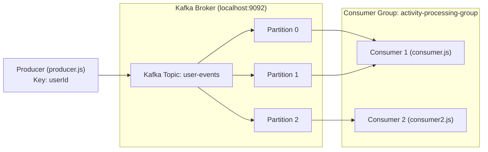

# 🚀 Apache Kafka Learning & Practice Lab (Node.js & KafkaJS)

A hands-on, practical sandbox for learning **Apache Kafka** core concepts using **Node.js** and **KafkaJS**. This repository contains working code simulating an event-driven architecture (Instagram-like user activity events), demonstrating how producers publish events, how topics partition data, and how consumer groups scale message consumption.

---

## 📌 What You'll Learn

- **Kafka Broker & Topics**: How Kafka organizes real-time message streams into topics.
- **Message Keys & Partitioning**: How message keys (e.g., `userId`) guarantee that events for the same user always land in the same partition in sequential order.
- **Producers**: Connecting to the broker and publishing structured JSON events.
- **Consumers & Consumer Groups**: How Kafka balances partitions across multiple consumer instances in the same consumer group (`activity-processing-group`).
- **Offsets & Message Tracking**: How Kafka tracks the exact position of processed messages in each partition.

---

## 🏗️ Architecture & Flow



---

## 📂 Repository Structure

```text
apache-kafka/
├── docker-compose.yml          # One-click Kafka broker setup (KRaft mode, no Zookeeper required)
├── .gitignore                  # Ignores node_modules and transient files
└── kafka-lab/
    ├── package.json            # Node.js dependencies and run scripts
    ├── producer.js             # Publishes simulated user activity events (LIKE / LOGIN)
    ├── consumer.js             # First consumer listening on 'user-events' topic
    └── consumer2.js            # Second consumer in the same group to demonstrate load balancing
```

---

## ⚡ Quick Start Guide

### 1. Prerequisites
- [Node.js](https://nodejs.org/) (v16 or higher)
- [Docker & Docker Compose](https://www.docker.com/) (to run Kafka locally)

---

### 2. Start Apache Kafka
You can spin up an Apache Kafka broker in KRaft mode (no Zookeeper needed) using the included `docker-compose.yml`:

```bash
docker compose up -d
```

Verify that the Kafka container is running:
```bash
docker ps
```
The broker will be available at `localhost:9092`.

---

### 3. Install Node.js Dependencies
Navigate to the `kafka-lab` directory and install `kafkajs`:

```bash
cd kafka-lab
npm install
```

---

### 4. Run the Consumers

Open a terminal and start **Consumer 1**:
```bash
npm run start:consumer
# or: node consumer.js
```
*Output:*
```text
Consumer connected!
Waiting for events...
```

*(Optional - Recommended for learning load balancing)*: Open a second terminal and start **Consumer 2**:
```bash
cd kafka-lab
npm run start:consumer2
# or: node consumer2.js
```

---

### 5. Run the Producer

In another terminal, run the **Producer** to send 10 simulated events:
```bash
cd kafka-lab
npm run start:producer
# or: node producer.js
```

*Producer Output:*
```text
Connected to Kafka!
Sent: user-1 | Action: LOGIN | Partition: 1 | Offset: 0
Sent: user-2 | Action: LIKE  | Partition: 0 | Offset: 0
Sent: user-3 | Action: LOGIN | Partition: 2 | Offset: 0
Sent: user-4 | Action: LIKE  | Partition: 0 | Offset: 1
...
All events sent successfully!
```

---

## 🔍 Code Walkthrough & Core Concepts

### 1. Producer (`kafka-lab/producer.js`)
- Initializes a Kafka client connecting to `localhost:9092`.
- Simulates user interactions with fields: `eventId`, `userId`, `action` (`LIKE` or `LOGIN`), `postId`, and `timestamp`.
- **Key Partitioning**: Sends messages with `key: event.userId`. Kafka computes a hash of the key to route messages. This guarantees:
  - All actions performed by `user-1` will **always** go to the same partition.
  - Events for that user will be processed **strictly in chronological order**.

### 2. Consumers (`kafka-lab/consumer.js` & `kafka-lab/consumer2.js`)
- Both consumers share the same `groupId: 'activity-processing-group'`.
- Subscribes to `user-events` with `fromBeginning: true`.
- **Horizontal Scaling & Load Balancing**:
  - When only **Consumer 1** is running, it reads from all topic partitions.
  - When **Consumer 2** joins, Kafka triggers a **rebalance** and divides the partitions among Consumer 1 and Consumer 2.
  - Neither consumer duplicates work; each message is processed exactly once by the group.

---

## 🧪 Experiments to Try

1. **Observe Key Partitioning**: Run the producer multiple times. Notice how `user-2` always lands on the exact same partition every single run.
2. **Observe Consumer Rebalancing**:
   - Start `consumer.js`.
   - Start `producer.js` -> notice `consumer.js` handles every message.
   - Start `consumer2.js` alongside `consumer.js`.
   - Run `producer.js` again -> watch the messages split across both consumer terminals!
3. **Consumer Failure Recovery**:
   - Stop Consumer 1 (`Ctrl + C`) while Consumer 2 is still running.
   - Notice Kafka immediately hands all partitions back to Consumer 2 without losing unprocessed offsets.

---

## 🛠️ Handy Kafka CLI Commands (Docker)

If you want to inspect Kafka directly inside the Docker container:

```bash
# List all topics
docker exec -it kafka-learning-broker /opt/kafka/bin/kafka-topics.sh --bootstrap-server localhost:9092 --list

# Describe a topic (view partitions & replicas)
docker exec -it kafka-learning-broker /opt/kafka/bin/kafka-topics.sh --bootstrap-server localhost:9092 --describe --topic user-events

# Describe consumer group (check lag, offsets, and assigned partitions)
docker exec -it kafka-learning-broker /opt/kafka/bin/kafka-consumer-groups.sh --bootstrap-server localhost:9092 --describe --group activity-processing-group
```

---

## 🛑 Stopping Kafka

When you're done practicing, stop the Docker container:

```bash
docker compose down
```

---

## 📄 License
MIT / Practice Project - feel free to clone, modify, and experiment!
