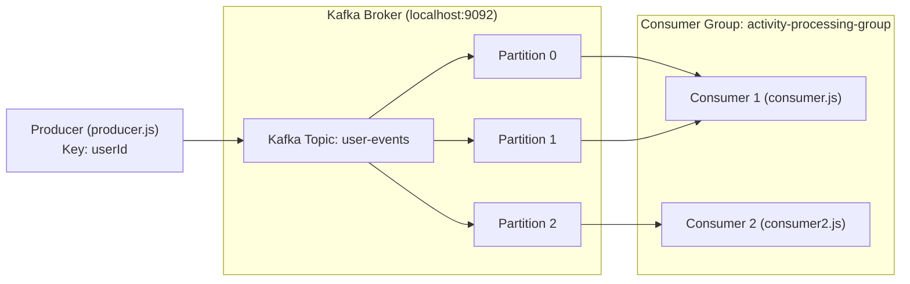

# 🏛️ Learning System Design: Practical & Hands-On

A comprehensive, hands-on repository dedicated to learning and mastering **System Design and Distributed Systems** through practical code, real-world patterns, and runnable lab environments.

---

## 🗺️ System Design Learning Roadmap

| Module | Topic | Implementation / Lab | Status |
| :--- | :--- | :--- | :--- |
| **01** | **Distributed Message Streaming & Pub-Sub** | Apache Kafka (Event-Driven Architecture) | ✅ Completed |
| **02** | **Distributed Caching & In-Memory Store** | Redis (Cache-Aside, Write-Through, Invalidation) | ⏳ Coming Soon |
| **03** | **API Rate Limiting & Throttling** | Token Bucket / Leaky Bucket Algorithms | ⏳ Coming Soon |
| **04** | **Load Balancing & Reverse Proxies** | NGINX / Round Robin & Least Connections | ⏳ Coming Soon |
| **05** | **Database Scaling & Partitioning** | Sharding, Read-Replicas & Replication Lag | ⏳ Coming Soon |
| **06** | **Consistency & Consensus** | Raft / Distributed Transactions (2PC, Saga) | ⏳ Coming Soon |

---

## 📦 Module 01: Apache Kafka & Event-Driven Architecture

This module implements a practical event-driven system simulating an **Instagram-like user activity feed** using **Node.js** and **KafkaJS**. It explores how modern distributed systems handle high-throughput event streams with zero message loss and guaranteed ordering.

### 🧠 Core Concepts Covered

1. **Brokers & Topics**: Real-time event streams segmented into high-throughput append-only logs.
2. **Message Partitioning by Key**: Using `userId` as the message key ensures all events from a given user are routed to the same partition, preserving **strict chronological order**.
3. **Consumer Groups**: Horizontal scaling pattern where Kafka distributes partitions among active consumer instances in the same group (`activity-processing-group`).
4. **Partition Rebalancing**: How Kafka automatically reallocates partition ownership when consumer instances join or leave.
5. **Offsets & Commit Strategies**: Tracking message delivery positions to prevent duplication and message loss.

---

### 🏗️ Architecture Diagram



---

### 📂 Lab Directory Structure

```text
Learning-System-Desgin/
├── docker-compose.yml          # One-click Kafka broker in KRaft mode (no Zookeeper needed)
├── .gitignore                  # Clean gitignore excluding node_modules and logs
├── README.md                   # System design roadmap & lab documentation
└── kafka-lab/
    ├── package.json            # Dependencies and npm shortcut scripts
    ├── producer.js             # Simulates 10 user events (LIKE / LOGIN) with message keys
    ├── consumer.js             # First consumer listening on 'user-events'
    └── consumer2.js            # Second consumer in the same group (demonstrates load balancing)
```

---

### ⚡ Quick Start: Running the Kafka Lab

#### 1. Prerequisites
- [Node.js](https://nodejs.org/) (v16+)
- [Docker & Docker Compose](https://www.docker.com/)

#### 2. Start Kafka Broker
Spin up Apache Kafka in KRaft mode:
```bash
docker compose up -d
```
Verify the container is healthy:
```bash
docker ps
```
The broker listens at `localhost:9092`.

#### 3. Install Dependencies
```bash
cd kafka-lab
npm install
```

#### 4. Start the Consumers
In Terminal 1:
```bash
npm run start:consumer
```

*(Optional for load balancing)* In Terminal 2:
```bash
npm run start:consumer2
```

#### 5. Produce User Events
In Terminal 3:
```bash
npm run start:producer
```

---

### 🧪 System Design Experiments to Try

1. **Guaranteed Ordering by Partition Key**:
   - Inspect the logs for `userId: "user-2"`.
   - Observe that every action for `user-2` routes to the exact same partition every single time.
2. **Consumer Group Load Balancing**:
   - Run both `consumer.js` and `consumer2.js` side-by-side.
   - Run `producer.js` and see partitions automatically shared between the two consumers.
3. **Fault Tolerance & Rebalancing**:
   - Terminate Consumer 1 with `Ctrl + C`.
   - Observe Consumer 2 immediately picking up Consumer 1's assigned partitions without dropping events.

---

### 🛠️ Useful Kafka CLI Commands (Docker)

```bash
# List all topics
docker exec -it kafka-learning-broker /opt/kafka/bin/kafka-topics.sh --bootstrap-server localhost:9092 --list

# Inspect topic partitions & replicas
docker exec -it kafka-learning-broker /opt/kafka/bin/kafka-topics.sh --bootstrap-server localhost:9092 --describe --topic user-events

# Inspect consumer group lag and partition assignments
docker exec -it kafka-learning-broker /opt/kafka/bin/kafka-consumer-groups.sh --bootstrap-server localhost:9092 --describe --group activity-processing-group
```

---

### 🛑 Tear Down

```bash
docker compose down
```

---

## 🤝 Contributing & Learning
This repository is an ongoing journey through system design principles. New modules and real-world architectures will be added regularly. Feel free to star ⭐, fork, and practice along!
