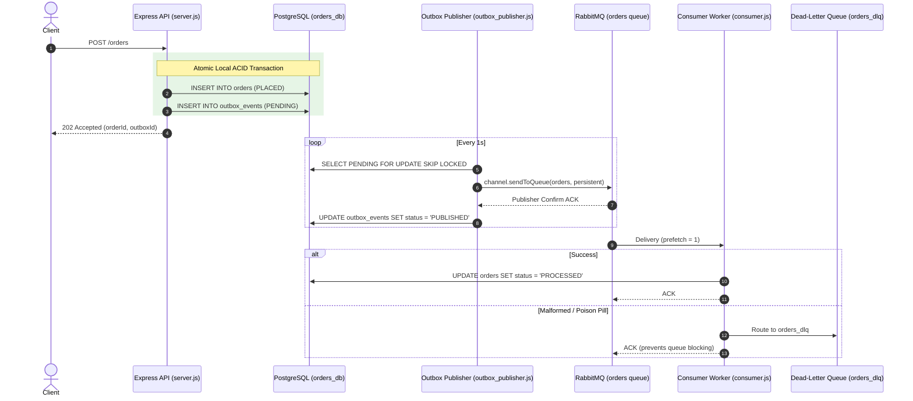

# 🐇 Module 02: RabbitMQ & Transactional Outbox Pattern

A production-grade System Design implementation demonstrating **reliable asynchronous messaging**, the **Transactional Outbox Pattern** (solving the distributed dual-write problem), **Dead-Letter Queues (DLQ)**, and **backpressure** using **RabbitMQ**, **PostgreSQL**, and **Node.js**.

---

## 📌 System Design Problems Solved

In distributed systems and microservices architectures, updating a database and publishing an event to a message broker (the **Dual-Write Problem**) cannot be done in a single distributed transaction without heavy two-phase commit (2PC) locks:
- ❌ *If you update DB first and the broker/app crashes*: The event is never published, leading to inconsistent state.
- ❌ *If you publish to broker first and the DB transaction fails*: Consumers process a phantom event that doesn't exist in the database.

### 💡 The Solution: Transactional Outbox Pattern
1. **Atomic Local Transaction**: Write both the business entity (`orders`) and the event payload (`outbox_events`) to PostgreSQL in a single ACID transaction (`BEGIN ... COMMIT`).
2. **Reliable Poller / Publisher**: An asynchronous background worker polls pending events using `SELECT ... FOR UPDATE SKIP LOCKED` and publishes them to RabbitMQ with publisher confirms.
3. **Idempotent Mark-as-Published**: Once RabbitMQ confirms receipt, the outbox record is marked as `PUBLISHED`.
4. **Consumer Resilience**:
   - **Poison Pill Protection**: Malformed/unparseable messages are safely forwarded to a Dead-Letter Queue (`orders_dlq`) so queues never stall.
   - **Backpressure**: `channel.prefetch(1)` ensures workers process only one unacknowledged message at a time.
   - **Retry & DLQ Routing**: Transient failures are retried before dead-lettering.

---

## 🏗️ Architecture & Message Flow



---

## 📂 Directory Structure

```text
rabbitmq-demo/
├── docker-compose.yml          # PostgreSQL 16 + RabbitMQ (with Management Dashboard)
├── init.sql                    # Database schema: orders & outbox_events tables
├── .env.example                # Sample environment variables
├── server.js                   # REST API & Web Dashboard server
├── outbox_publisher.js         # Transactional Outbox poller and RabbitMQ publisher
├── consumer.js                 # Resilient consumer with DLQ, retries, and prefetch
├── producer.js                 # Direct test producer
├── db.js                       # PostgreSQL connection pool configuration
├── run_tests.ps1               # Automated test suite (PowerShell)
├── package.json                # Project dependencies and run scripts
└── public/
    └── index.html              # Interactive real-time Web Dashboard
```

---

## ⚡ Quick Start Guide

### 1. Start Infrastructure (PostgreSQL & RabbitMQ)

```bash
docker compose up -d
```

Verify containers are running:
- **PostgreSQL**: `localhost:5432` (`orders_db`)
- **RabbitMQ**: `localhost:5672` (AMQP)
- **RabbitMQ Management Dashboard**: [http://localhost:15672](http://localhost:15672) (User: `guest` / Pass: `guest`)

---

### 2. Install Dependencies

```bash
npm install
```

Copy the environment config:
```bash
cp .env.example .env
```

---

### 3. Start the Services

Open 3 separate terminals to observe each component:

**Terminal 1 — Start the API Server & Dashboard:**
```bash
npm run start:server
```
Visit the interactive dashboard in your browser: [**http://localhost:3000**](http://localhost:3000)

**Terminal 2 — Start the Outbox Publisher:**
```bash
npm run start:publisher
```

**Terminal 3 — Start the Resilient Consumer Worker:**
```bash
npm run start:consumer
```

---

## 🧪 Interactive Testing

You can use the built-in automated test suite:

```powershell
.\run_tests.ps1 -Test 1
```

Or trigger an order directly via `curl` / `Invoke-RestMethod`:

```bash
curl -X POST http://localhost:3000/orders \
  -H "Content-Type: application/json" \
  -d '{"customer": "Bhavesh", "product": "4K OLED Monitor", "quantity": 1}'
```

### Observe:
1. The API immediately returns `202 Accepted` with both `orderId` and `outboxId`.
2. Inspect the Postgres database:
   ```bash
   docker exec -it postgres-demo psql -U postgres -d orders_db -c "SELECT * FROM outbox_events;"
   ```
3. Watch the Outbox Publisher grab the pending event, confirm delivery to RabbitMQ, and transition its status from `PENDING` ➔ `PUBLISHED`.
4. Watch the consumer pick up the message and transition order status to `PROCESSED`.

---

## 🛑 Tear Down

```bash
docker compose down -v
```
